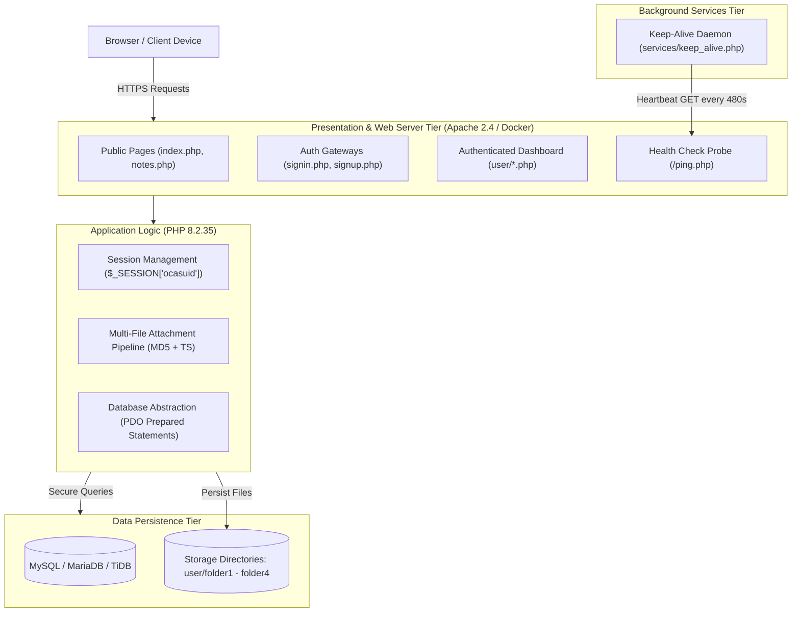
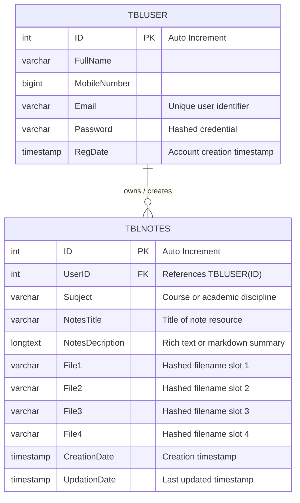
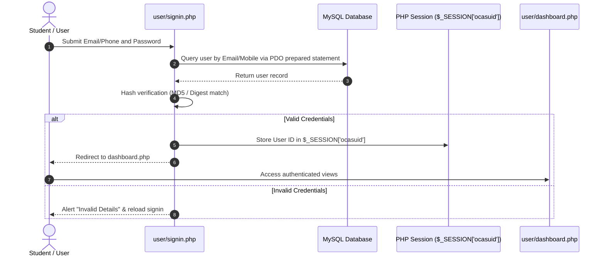

# System Architecture & Component Design

This document details the architectural principles, component structure, data models, and operational lifecycle of the **Notes Management System**.

---

## 1. High-Level Architecture

The Notes Management System is architected as a modular, three-tier web application built on PHP 8.2 and MySQL/MariaDB, containerized via Docker and deployed with an automated background resilience daemon.



---

## 2. Technology Stack Breakdown

| Tier | Component | Specification | Description |
| :--- | :--- | :--- | :--- |
| **Runtime** | PHP | `8.2.35-apache` | Official pinned hardened PHP Apache base image |
| **Web Server** | Apache | `2.4.x` | Handles routing, static asset caching, and virtual hosts |
| **Database** | MySQL / MariaDB | `8.0+ / 10.4+` | Relational storage for user accounts and document records |
| **Data Access** | PHP Data Objects | `PDO MySQL` | Parameterized database queries preventing SQL injection |
| **Frontend Framework** | Bootstrap | `5.0.0+` | Responsive grid layouts and modern UI components |
| **Styling & Assets** | CSS / SCSS | Custom + SASS | Responsive styles, animations, and color schemes |
| **Client Scripts** | JavaScript | ES6+ & jQuery | Dynamic UI interactions, modals, and client-side validation |
| **Containerization** | Docker | Multi-stage ready | Standardized container builds with entrypoint automation |
| **Monitoring** | Keep-Alive Daemon | PHP & Node.js | Automated polling preventing server sleep on Render |

---

## 3. Directory Layout & Module Responsibilities

```text
Notes Management System/
├── assets/                  # Public global assets
│   ├── css/                 # Global styles, Bootstrap, SlickNav, animations
│   ├── img/                 # Branding, logos, favicons, illustrations
│   ├── js/                  # Vendor and custom JavaScript utilities
│   └── screenshots/         # Application interface previews for documentation
├── database/                # Database migrations and seed datasets
│   └── notes.sql            # Core SQL schema, table definitions, and initial records
├── includes/                # Shared presentation templates for public views
│   ├── header.php           # Global top navigation bar and responsive header
│   └── footer.php           # Global bottom footer, legal copy, and back-to-top
├── services/                # Background operational workers
│   ├── keep_alive.php       # PHP cURL-based heartbeat daemon (480s loop)
│   └── keep_alive.js        # Node.js HTTPS-based heartbeat daemon alternative
├── user/                    # Authenticated student/user portal
│   ├── css/ & js/ & lib/    # Portal-specific styling, charts, and date pickers
│   ├── folder1/ - folder4/  # Segregated disk storage for uploaded note attachments
│   ├── includes/            # Dashboard partials (sidebar.php, header.php, dbconnection.php)
│   ├── add-notes.php        # Form handler for creating new notes with file attachments
│   ├── manage-notes.php     # Tabular management view with pagination and actions
│   ├── edit-notes.php       # Metadata updater for existing note records
│   ├── changefile1.php-4    # Isolated replacement pipelines for specific file slots
│   ├── dashboard.php        # Metric aggregations (total notes uploaded, etc.)
│   ├── profile.php          # User profile view and personal information editor
│   ├── setting.php          # Password change and account security configurations
│   ├── delete-account.php   # Account removal confirmation and teardown workflow
│   ├── signin.php           # User authentication form and credential verification
│   ├── signup.php           # User registration and duplicate check validation
│   └── forgot-password.php  # Credential recovery and password reset verification
├── Dockerfile               # Container build instructions with pinned PHP base
├── entrypoint.sh            # Container init script (spawns daemon & Apache)
├── index.php                # Public landing page with featured features
├── notes.php                # Public searchable repository of educational notes
├── ping.php                 # Zero-DB health check probe for uptime monitoring
├── robots.txt               # Search engine crawler permissions and directives (Disallow: /)
└── site.webmanifest         # PWA and mobile shortcut manifest configuration
```

---

## 4. Database Schema & Data Models

The relational schema is lightweight and optimized for educational document sharing.

### Entity Relationship Model



### Table Specifications

#### 1. `tbluser`
* **Primary Key:** `ID` (INT AUTO_INCREMENT)
* **Identity Fields:** `FullName`, `Email`, `MobileNumber`
* **Security:** `Password` stores hashed authentication digest.
* **Audit:** `RegDate` defaults to `CURRENT_TIMESTAMP`.

#### 2. `tblnotes`
* **Primary Key:** `ID` (INT AUTO_INCREMENT)
* **Foreign Key:** `UserID` connects the note to its author in `tbluser`.
* **Content:** `Subject`, `NotesTitle`, `NotesDecription`.
* **Attachment Slots:** `File1`, `File2`, `File3`, `File4` contain hash-obfuscated filenames residing on the filesystem (`user/folder1/` through `user/folder4/`).
* **Audit:** `CreationDate` and `UpdationDate` (auto-updates via `ON UPDATE CURRENT_TIMESTAMP`).

---

## 5. Core Workflows & Pipelines

### Authentication & Session Lifecycle



### Multi-File Attachment Upload Pipeline

To prevent file collision and malicious path traversal, note uploads adhere to the following pipeline:
1. **File Receipt:** Files uploaded via `add-notes.php` or `changefile1-4.php` are extracted from `$_FILES`.
2. **Hash Obfuscation:** The file extension is parsed, and a unique hash is generated:
   $$\text{Stored Filename} = \text{md5}(\text{filename}) + \text{current\_time} + \text{extension}$$
3. **Partitioned Storage:** Attachments are segregated across four distinct folders:
   - File 1 $\rightarrow$ `user/folder1/`
   - File 2 $\rightarrow$ `user/folder2/`
   - File 3 $\rightarrow$ `user/folder3/`
   - File 4 $\rightarrow$ `user/folder4/`
4. **Database Registration:** The obfuscated filename string is stored in the corresponding slot in `tblnotes`.

---

## 6. Operational Resilience & Keep-Alive Daemon

Free-tier hosting providers (such as Render) automatically suspend idle containers after 15 minutes of zero incoming HTTP traffic. This causes search engine crawlers (Googlebot) and users to experience long cold-start timeouts or crawl failures.

### Keep-Alive Architecture

```mermaid
sequenceDiagram
    autonumber
    participant Daemon as Keep-Alive Daemon (services/keep_alive.php)
    participant Server as Web Server (Apache)
    participant Probe as Health Probe (/ping.php)

    Note over Daemon: Spawned on container startup via entrypoint.sh
    Daemon->>Daemon: Sleep initial 20s (wait for port 80 bind)
    loop Every 480 Seconds (8 Minutes)
        Daemon->>Probe: HTTP GET https://.../ping.php
        Probe->>Server: Validate lightweight endpoint (No DB overhead)
        Server-->>Daemon: HTTP 200 OK {"status":"healthy"}
        Note over Daemon: Activity counter refreshed; prevents container suspension
    end
```

* **Health Endpoint (`/ping.php`):** Returns an instantaneous `200 OK` JSON response without querying the database, conserving connection pool limits and memory.
* **Redundancy:** Can be run natively within the container or externally via `services/keep_alive.js` using Node.js.

