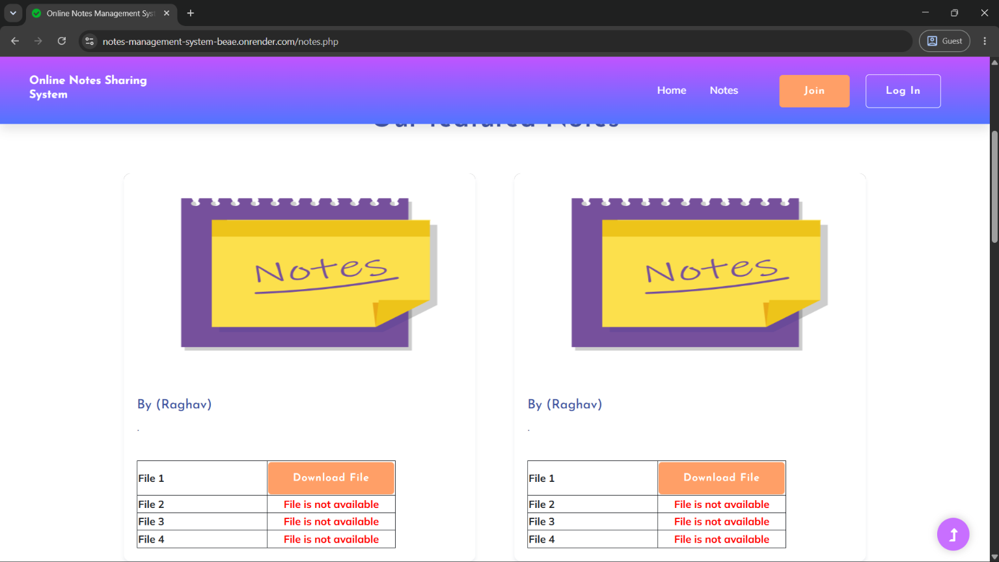
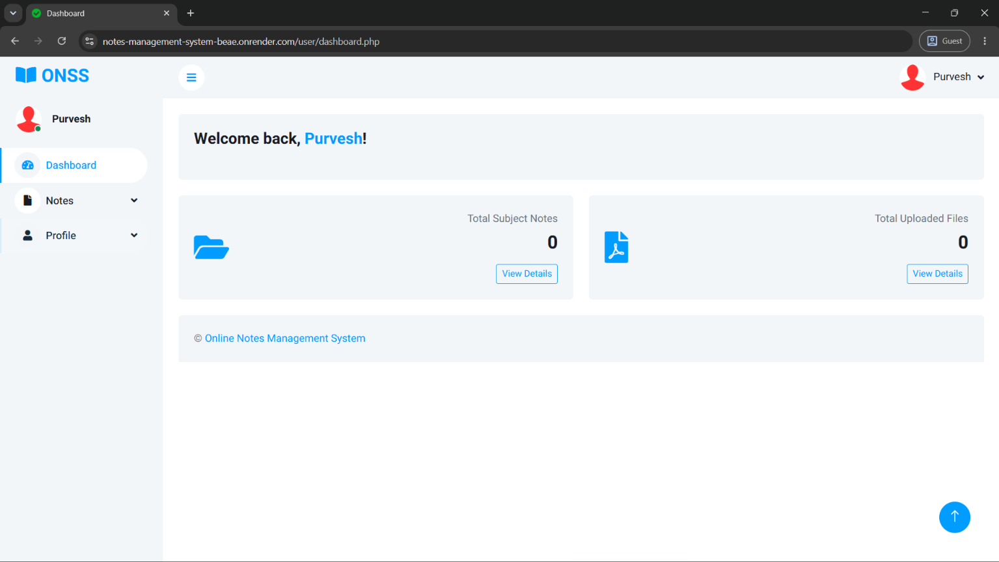
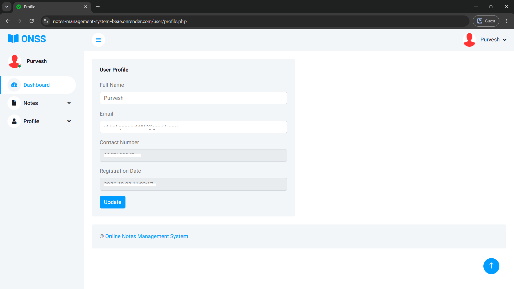
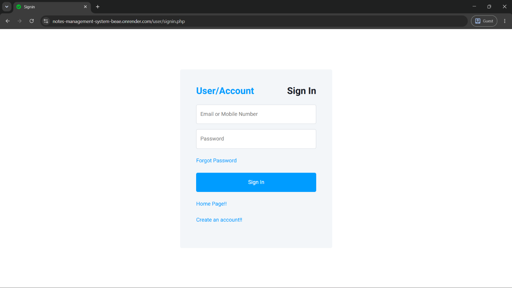
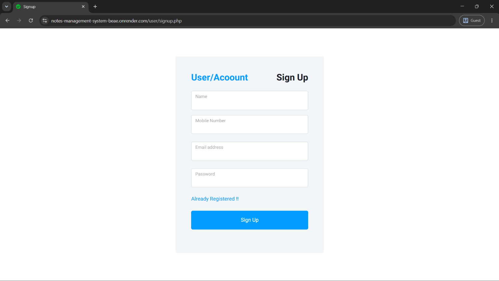

<div align="center">


<br/><br/>

[](https://php.net/)
[](https://www.mysql.com/)
[](https://getbootstrap.com/)
[](https://opensource.org/licenses/MIT)
[](#)

<p align="center">
  <strong>An enterprise-grade, web-based platform for organizing, storing, and distributing academic notes and documentation.</strong>
</p>

<a href="https://notes-management-system-beae.onrender.com/">
  
</a>

</div>

---

## Table of Contents

- [Overview](#overview)
- [System Architecture](#system-architecture)
- [Key Features](#key-features)
- [Interface Preview](#interface-preview)
- [Installation & Local Setup](#installation--local-setup)
- [Production Deployment & Keep-Alive Service](#production-deployment--keep-alive-service)
- [Security Advisories](#security-advisories)
- [Contributors](#contributors)
- [License](#license)
- [Contact](#contact)

---

## Overview

The **Notes Management System** is a full-featured web application designed to facilitate centralized knowledge sharing for students, educators, and organizations. The system provides secure role-based access control, file attachment handling across multiple formats, and chronological revision tracking.

---

## System Architecture

| Layer | Technologies |
| :--- | :--- |
| **Backend Runtime** | PHP 8.2 (Pinned Base Container: `php:8.2.35-apache`) |
| **Database** | MySQL / MariaDB / Distributed TiDB Cluster |
| **Frontend UI** | HTML5, CSS3, JavaScript (ES6+), jQuery, Bootstrap 5 |
| **Asset Icons** | FontAwesome 5, Themify Icons, Flaticon |
| **Deployment** | Docker, Apache 2, Render Cloud Hosting |

---

## Key Features

- **Authentication & Security:** Secure user registration, credential hashing with MD5/Bcrypt, session isolation, and account deletion confirmation workflows.
- **Document Management:** Full CRUD (Create, Read, Update, Delete) capability for educational notes and study materials.
- **Multi-File Attachment Pipeline:** Support for up to 4 file attachments per document with dynamic file replacement capabilities.
- **Audit & Revision History:** Automatic timestamping and tracking of document updates and user modifications.
- **Public Resource Repository:** Filterable and paginated directory allowing visitors to discover and review open-access notes.
- **Responsive Dashboard:** Optimized for desktop, tablet, and mobile browsers with collapsible sidebars and data tables.

---

## Interface Preview

| Homepage | Notes Feed |
| :---: | :---: |
|  |  |

| Dashboard Panel | User Profile |
| :---: | :---: |
|  |  |

| Authentication (Sign In) | User Registration (Sign Up) |
| :---: | :---: |
|  |  |

---

## Installation & Local Setup

### 1. Prerequisites

- PHP 7.4 or 8.x
- MySQL 5.7+ or MariaDB 10.3+
- Web server environment (Apache, Nginx, XAMPP, or Docker)

### 2. Clone the Repository

```bash
git clone https://github.com/PurveshShinde/Notes_Management_System.git
cd Notes_Management_System
```

### 3. Database Initialization

1. Access your database management console (such as phpMyAdmin).
2. Create a database named `notes`.
3. Import the schema and seed data located at `database/notes.sql`.

### 4. Environment Configuration

Verify credentials in `user/includes/dbconnection.php` or set environment variables:

```php
define('DB_SERVER', 'localhost');
define('DB_USER', 'root');
define('DB_PASS', '');
define('DB_NAME', 'notes');
```

---

## Production Deployment & Keep-Alive Service

When deployed on free-tier container platforms such as Render, web instances suspend execution after 15 minutes of inbound inactivity. To ensure zero cold starts and maintain 100% availability for search indexing, this repository includes an automated keep-alive pipeline.

### Health Check Endpoint

A dedicated, lightweight health check endpoint is available at `/ping.php`. It responds with a `200 OK` status and current server timestamp without executing database queries:

```text
GET https://notes-management-system-beae.onrender.com/ping.php
```

### Keep-Alive Service Implementation

1. **Docker Container Daemon:** The container runs an internal daemon (`services/keep_alive.php`) that issues an external heartbeat request every 8 minutes (480 seconds).
2. **Standalone Daemon:** To run a dedicated background ping service locally or from an external server:
   ```bash
   node services/keep_alive.js
   ```

---

## Security Advisories

### PHP 8.2.35 Base Image Pinning (Applied: 2026-10-23)

The container configuration explicitly locks the base image to `php:8.2.35-apache` to prevent non-deterministic builds and mitigate critical vulnerabilities present in unpatched PHP releases prior to version 8.2.35.

| Parameter | Previous Setting | Current Hardened Setting |
| :--- | :--- | :--- |
| **Dockerfile Base** | `php:8.2-apache` (Floating Tag) | `php:8.2.35-apache` (Pinned Release) |
| **Patch Level** | Unpredictable / Variable | 8.2.35 (Verified) |
| **Build Reproducibility** | Non-deterministic | Deterministic |

---

## Contributors

- **Purvesh Shinde** - [GitHub Profile](https://github.com/PurveshShinde)
- **Amey Gawade** - [GitHub Profile](https://github.com/ameyg11)
- **Prathamesh Ambekar** - [GitHub Profile](https://github.com/PrathameshAmbekar15)

<div align="left">
  <a href="https://github.com/PurveshShinde">
    
  </a>
  <a href="https://github.com/ameyg11">
    
  </a>
  <a href="https://github.com/PrathameshAmbekar15">
    
  </a>
</div>

---

## License

This project is licensed under the [MIT License](LICENSE).

---

## Contact

- **Lead Maintainer:** Purvesh Shinde
- **Email:** shindepurvesh007@gmail.com
- **Repository:** [https://github.com/PurveshShinde/Notes_Management_System](https://github.com/PurveshShinde/Notes_Management_System)
