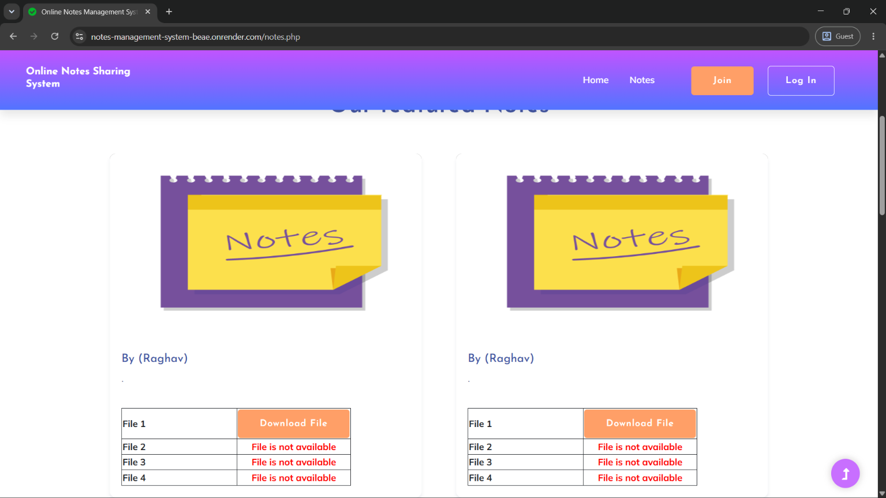
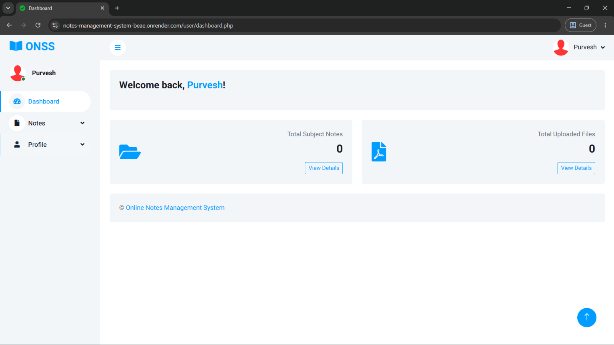
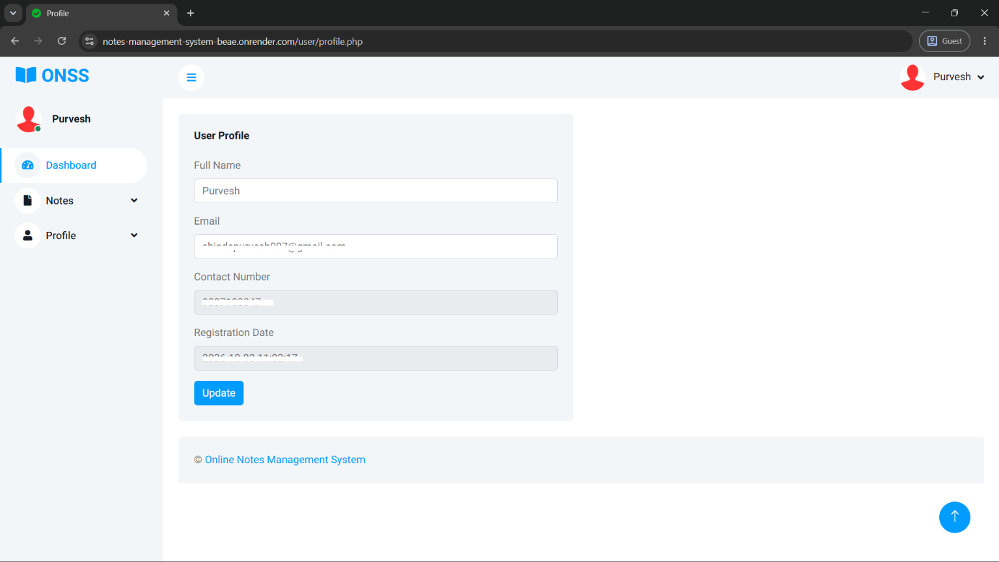
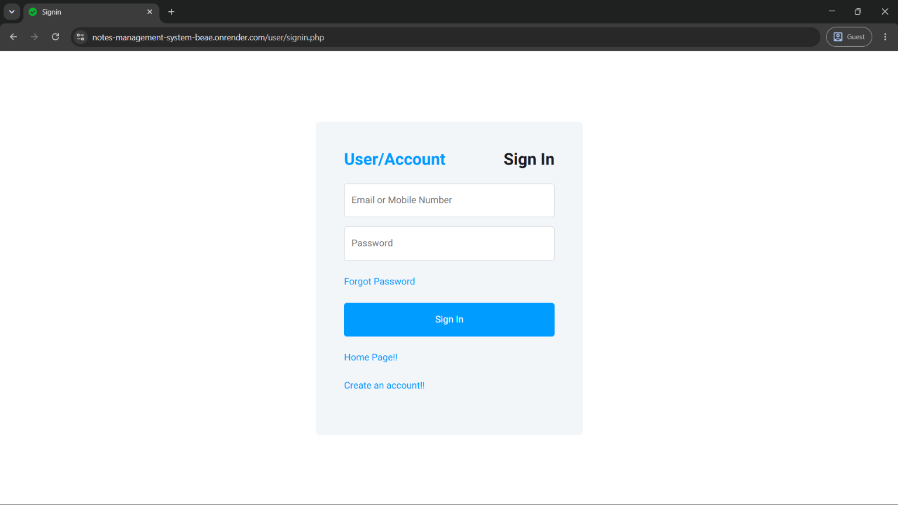
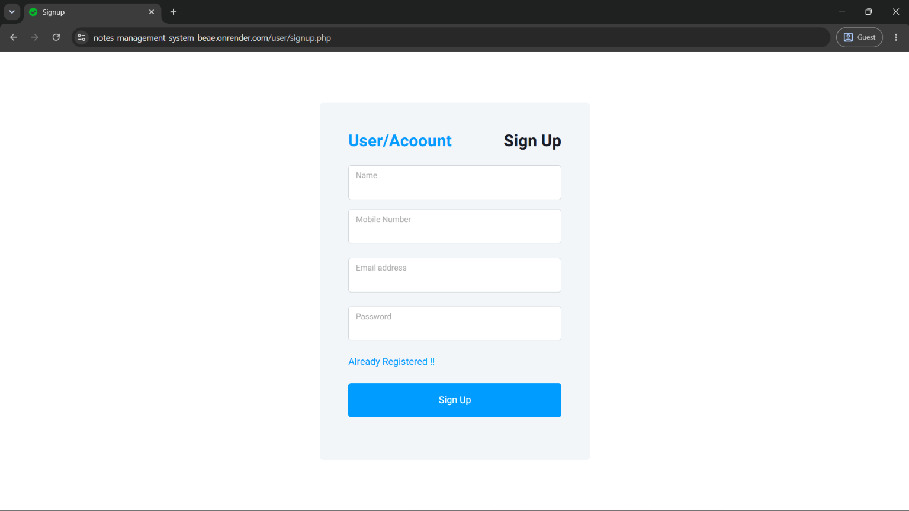

  

  <strong>An enterprise-grade, web-based platform for organizing, storing, and distributing academic notes and documentation.</strong>

---

## Overview

The **Notes Management System** is a full-featured web application engineered to facilitate centralized knowledge sharing for students, educators, and academic institutions. Powered by PHP 8.2 and MySQL, the system delivers secure role-based session management, multi-file attachment uploads, chronological revision tracking, and an automated keep-alive daemon ensuring continuous availability.

---

## Key Features

* **Secure Authentication & Account Lifecycle:** Registration validation, credential hashing, session isolation, and self-service account deletion workflows.
* **Document Management Engine:** Full CRUD (Create, Read, Update, Delete) capability for educational notes and course documentation.
* **Multi-File Attachment Pipeline:** Support for up to 4 file attachments per document with dedicated replacement pipelines (`changefile1-4.php`).
* **Public Knowledge Explorer:** Filterable and paginated directory allowing visitors to discover, review, and download open-access study materials.
* **Operational Keep-Alive Resilience:** Built-in background daemon and lightweight zero-DB health check probe (`/ping.php`) preventing container sleep on free-tier cloud platforms.
* **Responsive Modern UI:** Built with Bootstrap 5 and customized SCSS, fully optimized across desktop, tablet, and mobile browsers.

---

## Interface Preview

| Homepage | Notes Feed |
| :---: | :---: |
|  |  |

| Dashboard Panel | User Profile |
| :---: | :---: |
|  |  |

| Authentication (Sign In) | User Registration (Sign Up) |
| :---: | :---: |
|  |  |

---

## Documentation Index

The project's documentation has been modularized into specialized guides for developers, maintainers, and community members:

| Document | Purpose & Description |
| :--- | :--- |
| **[Architecture & Design](ARCHITECTURE.md)** | System architecture, ER diagrams, component design, data flow, and directory layout. |
| **[Installation & Setup Guide](SETUP.md)** | Local build instructions, Docker setup, database initialization, and configuration. |
| **[Security & Privacy Policy](SECURITY.md)** | Vulnerability reporting procedures, base image hardening, SQL defenses, and data handling. |
| **[Contributing Guidelines](CONTRIBUTING.md)** | Developer workflows, coding standards, branch naming, and pull request procedures. |
| **[Code of Conduct](CODE_OF_CONDUCT.md)** | Community pledge, behavioral expectations, and moderation enforcement guidelines. |
| **[AI Agent Conventions](AGENTS.md)** | Operational directives, SEO preservation rules, and coding guardrails for AI agents. |
| **[License (MIT)](LICENSE)** | Full open-source MIT License terms and copyright attribution. |

---

## Contributors & Maintainers

- **Purvesh Shinde** - [GitHub Profile](https://github.com/PurveshShinde) (Lead Maintainer)
- **Amey Gawade** - [GitHub Profile](https://github.com/ameyg11) (Core Contributor)
- **Prathamesh Ambekar** - [GitHub Profile](https://github.com/PrathameshAmbekar15) (Core Contributor)

 

  
  
  

---

## License

This project is licensed under the terms of the [MIT License](LICENSE).  
Copyright (c) 2026 Purvesh Shinde.

---

## Contact & Support

* **Maintainer:** Purvesh Shinde
* **Email:** [shindepurvesh007@gmail.com](mailto:shindepurvesh007@gmail.com)
* **GitHub Repository:** [https://github.com/PurveshShinde/Notes_Management_System](https://github.com/PurveshShinde/Notes_Management_System)
